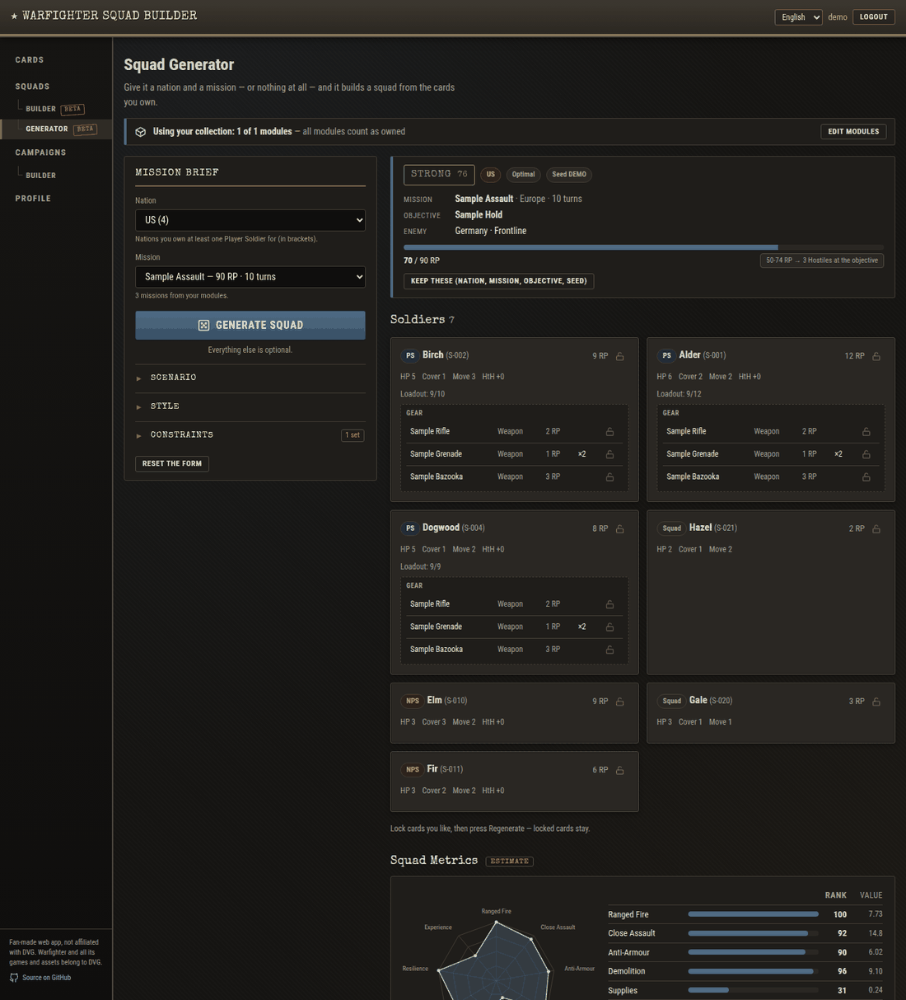

# Warfighter WWII - Squad Builder

A free, open-source web app for the [*Warfighter* WWII](https://www.dvg.com) card game: browse the cards, build
and validate squads, **generate a squad for a mission automatically**, and design campaigns. English and Spanish.

> **Fan-made, unofficial.** Not affiliated with or endorsed by DVG (Dan Verssen Games). Warfighter and all related
> games, names, cards and artwork belong to DVG; all rights belong to them. The repository includes the card data the app
> needs (a CSV of names, stats and card text) for the convenience of players, but **no card images or artwork** — see
> [NOTICE.md](NOTICE.md) and [docs/card_data.md](docs/card_data.md).


*The squad generator on the fictional demo card set.*

## Features

- **Cards browser** — fast search with a smart syntax (`t:weapon rp<5 …`), card details, hover image previews
  (images are supplied by you), per-language card text.
- **Squad builder** — pick a mission, objective and nation, add soldiers and gear, and get live validation: RP budget,
  Loadout (including the mission modifier), nation rules, duplicate skills, pre-printed gear, and which expansions
  you need to build it. Export/import as text, CSV or Tabletop Simulator; copy someone's squad
  ("based on"), like and comment; `[[Card names]]` in notes become links. *(beta)*
- **Squad generator** — give it a nation and a mission, or nothing at all, and it builds a squad **only from the
  expansions you own**. *Optimal* is deterministic; *Good enough* adds seeded variety plus optional twists. It picks
  weapons, skills and armor, explains why, flags problems (checks), and lets you lock cards and regenerate, open the
  result in the builder, or save it as a draft. *(beta)*
- **Squad metrics** — every squad gets nine estimated metrics (ranged fire, close assault, anti-armour, demolition,
  supplies, mobility, survivability, resilience, experience) shown as a radar chart and ranked against reference squads.
- **Campaign designer** — build campaigns from mission/objective pairs, with branching, rules and epilogues; import
  them from YAML files ([format](docs/campaign_yaml.md)) and export any campaign as **text or Markdown**.
- **Accounts and roles** — email-verified accounts and password reset. Two roles: *User* (manages their own squads and
  campaigns) and *Admin* (the `admin` account: can edit any squad or campaign and open admin-only views such as the
  translation editor and the **Users** page: list, enable/disable, delete and edit any account, set a new
  password without ever seeing one).
- **Collection** — **My Expansions** (user menu, top right, or the
  left menu) records which expansions you own; the squad generator and the card pickers only use those.
- **Translations** — English and Spanish UI; card texts can be translated (optionally machine-drafted) and reviewed in
  an admin-only editor.

## Quick start

You need Python 3.10+ (developed on 3.12) and `git`.

```bash
git clone https://github.com/meeplecoder/warfighter-squad-builder.git
cd warfighter-squad-builder
python3 -m venv .venv && source .venv/bin/activate      # Windows: .venv\Scripts\activate
pip install -r requirements.txt
cp .env.example .env
python scripts/import_cards.py                                     # loads cards/warfighter_cards.csv
python run.py                                                      # http://127.0.0.1:5000
```

Register an account (in development the verification link is printed in the terminal), then open **Generator**.
Full instructions — real card data, images, admin rights, deployment — are in **[INSTALL.md](INSTALL.md)**.

## Card data and images

- **Card data** — `cards/warfighter_cards.csv` holds the cards (names, stats, card text, expansion) in the simple format
  described in [docs/card_data.md](docs/card_data.md) and [docs/card_taxonomy.md](docs/card_taxonomy.md). It is
  DVG's content, included for convenience; see [NOTICE.md](NOTICE.md). You can import any other CSV with `--csv`.
- **Card images** — **not included.** If you own the game you can add your own scans locally (git-ignored); see
  [static/card_images/README.md](static/card_images/README.md).
- [`examples/cards.sample.csv`](examples/cards.sample.csv) is a small **fictional** set used by the tests and for
  screenshots.

## Project layout

```
app/            Flask application (API, models, rules, squad metrics, generator, auth, i18n)
static/         Single-page frontend: vanilla JS, no build step (app.js, campaigns.js, generator.js, i18n/)
scripts/        Importers and maintenance scripts (cards, translations, campaigns, metric reference, admin)
campaigns/      Example campaigns (YAML)
docs/           Format documentation
cards/          Card data (CSV)
examples/       Fictional demo card set (tests, screenshots)
tests/          pytest smoke tests
```

Tech: Flask 3, SQLAlchemy/SQLite, Flask-Login, Flask-Limiter, vanilla JavaScript. No JavaScript build step.

## Tests

```bash
pip install -r requirements-dev.txt
pytest
```

The tests run against the fictional demo data and also run in CI on every push and pull request.

## Contributing

Bug reports, ideas, translations and pull requests are welcome — see **[CONTRIBUTING.md](CONTRIBUTING.md)**. Please
read the content policy there first: contributions must never include DVG's card text or artwork. Security issues:
[SECURITY.md](SECURITY.md). Everyone is expected to follow the [Code of Conduct](CODE_OF_CONDUCT.md).

## License

The source code and documentation are released under the [MIT License](LICENSE). That license does **not** cover
Warfighter itself: see [NOTICE.md](NOTICE.md) for intellectual-property details and credits.
